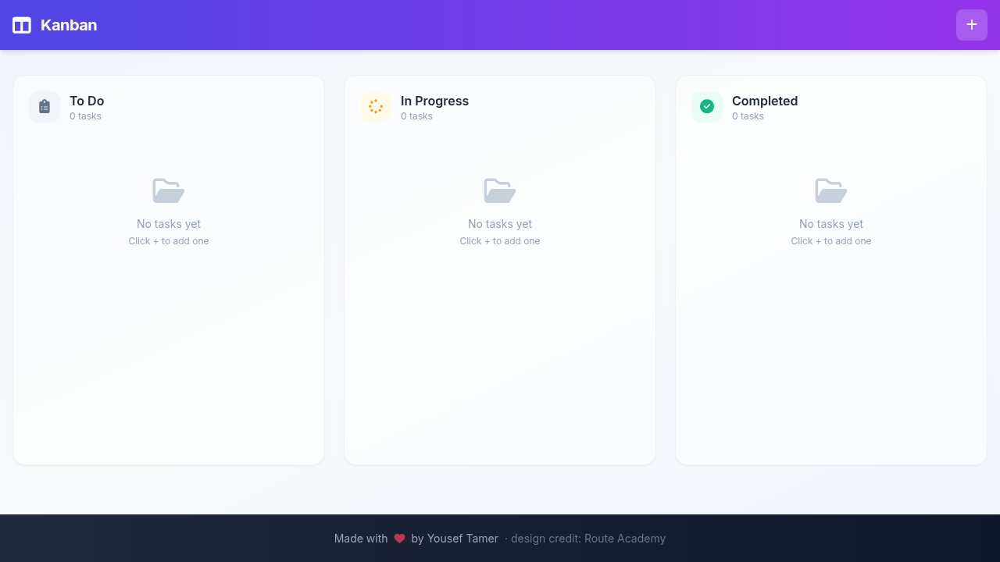

# Kanban Task Manager

A Trello-style Kanban board for organizing tasks across three columns: To Do, In Progress and Completed. Everything is saved in the browser.

**Live demo:** https://yosef-tamer206.github.io/Kanban-Task-Manager/



## Features

- Create, edit and delete tasks through a clean modal form
- Three workflow columns with per-column task counts
- Priority levels (high, medium, low) with color-coded badges
- Due dates with "due soon" and "overdue" indicators
- Move tasks between columns with one click
- Form validation with inline error messages
- Description character counter
- Automatic saving to `localStorage`, so tasks survive a refresh

## Tech Stack

- HTML5, CSS3, vanilla JavaScript (class-based)
- Tailwind CSS (CDN build)
- Font Awesome icons

## Run Locally

```bash
git clone https://github.com/Yosef-Tamer206/Kanban-Task-Manager.git
cd Kanban-Task-Manager
```

Open `index.html` in a browser.

## Notes

- Tasks are stored in your browser's `localStorage`. There is no backend, sync or multi-user support.
